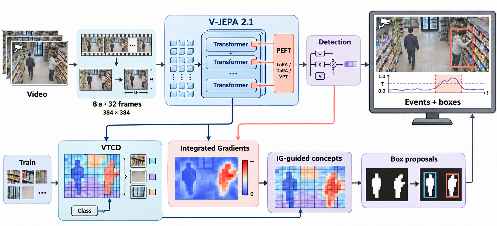
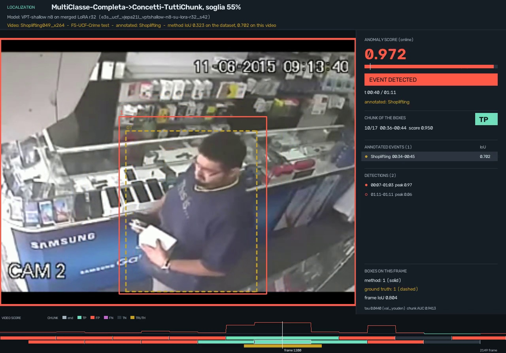

# Automatic Event Detection in Surveillance Videos with Video Foundation Models

Code of the master's thesis *Automatic Event Detection in Surveillance Videos with Video
Foundation Models* (University of Salerno, 2026).

The project detects anomalous events in surveillance video with a frozen video foundation
model, **V-JEPA 2.1 ViT-L**, and compares the two families of parameter-efficient
fine-tuning (PEFT) at equal budget: **prompt-based** methods (VPT) and
**reparameterization** methods (LoRA, DoRA). Every score is produced on **causal
windows** that end at the current instant, so the offline numbers describe the online
behaviour of the deployed system. The repository also contains the cross-dataset
evaluation, an efficiency and deployment study, an explainability toolkit, automatic
**spatial localization** of the event — box proposals from VTCD concepts chosen with
Integrated Gradients and routed by the class of the chunk — scored against a manually drawn
ground truth, an interactive demonstrator and a spatial annotation tool.

- **Author:** Antonio Apicella
- **Supervisors:** Prof. Antonio Greco, Prof. Mario Vento (MIVIA Lab, University of Salerno)

---




## Demonstrator video

[](https://github.com/apiantonio/V-JEPA_Event-Detection-Localization_with_PEFT/releases/download/demo-v1/demonstrator.mp4)

**[Watch the original cluster rendering (MP4, 72 seconds)](https://github.com/apiantonio/V-JEPA_Event-Detection-Localization_with_PEFT/releases/download/demo-v1/demonstrator.mp4).**
FS-UCF-Crime `Shoplifting049`: taking and concealing a phone in a shop. This is the
complete, unmodified movie from the latest existing cluster rendering collection,
`render_best_20261025`, with the updated EVD Studio interface: anomaly score and alarm,
chunk verdict, event and frame IoU, method boxes, dashed reference boxes and timeline.
The model is VPT-shallow on merged LoRA r32; localization uses B2, all-chunk VTCD
dictionaries and the 55% IG-mass rule. The screenshot is frame 1200 (40 s) of the same movie.

This is a qualitative **offline replay**: localization boxes are limited to annotated
intervals and can precede the causal alarm. It is not an online localization timing
measurement. Source identity, checksum and screenshot timestamp are recorded in
[media/demonstrator.json](media/demonstrator.json).

The [pipeline figure](media/pipeline.png) summarizes sampling, PEFT adaptation,
detection and class-routed IG + VTCD localization. Its frames and attribution maps are
schematic illustrations; the demonstrator above shows actual saved model outputs.


## Highlights

- **Reparameterization wins, prompts do not.** DoRA r=32 reaches **0.942 chunk AUC** on
  FS-UCF-Crime (mean of three seeds). At exactly the same number of trainable parameters
  (14.16 M), VPT-deep with 576 prompts falls *below* the frozen attentive probe.
- **Adaptation helps inside anomalous videos.** Over the frozen probe, reparameterization
  adds little chunk AUC but about **+0.04 AP** restricted to anomalous videos: it localizes
  the event within the video rather than separating anomalous from normal videos.
- **Prompts and low-rank updates are largely redundant.** Across the joint and sequential
  combinations of VPT with LoRA/DoRA evaluated on three seeds, none beats DoRA alone beyond
  the seed-to-seed spread, at up to three times its training cost. Longer training does not
  buy accuracy either: at seed 42, three and four epochs in continuation move LoRA and DoRA
  by less than 0.01 chunk AUC, and only the linear probe, under-trained at one epoch, gains.
- **Merging matters for deployment.** Unmerged, LoRA and DoRA are the slowest variants at
  inference (+42.8% and +83.7% latency); once merged into the backbone they cost the same
  as the frozen model. Alarm delay depends strongly on the 4 s window grid;
  direct end-to-end measurements and reconstructed component sums are reported separately.
- **Transfer to an unseen domain.** The same weights, without retraining or threshold
  re-estimation, keep 0.90 chunk AUC on the private MIVIA-Crime test set.
- **Where the event is, without box supervision.** The trained detector becomes a box
  proposer: Integrated Gradients picks the VTCD concepts that carry the anomaly, from the
  dictionary of the class chosen for the chunk. On the official metric (AP@[0.3:0.05:0.7]
  per event, 1 fps, mean of UCF-Crime and MIVIA-Crime) it reaches **25.9 offline AP**,
  against 11–18 for Grad-CAM, IG alone or VTCD concepts alone on the same detector and 23.3
  for the best class-free rule on the frozen baseline, scored against a spatial ground truth
  drawn on 179 test videos.
- **Against the laboratory's reference numbers** (same 8 s protocol): DoRA r=32 obtains
  94.41 / 90.29 chunk AUC on UCF-Crime / MIVIA-Crime, against the best values provided by
  the laboratory, 85.52 (VadCLIP) on UCF-Crime and 81.69 (the laboratory's method) on
  MIVIA-Crime. *The numbers of the other methods come from the laboratory and were not
  reproduced here.*

## Results

FS-UCF-Crime test set (290 videos, 9,116 chunks), protocol EDP-v2. Mean ± sample standard
deviation over seeds 42, 67 and 104; *AUC_a* / *AP_a* are restricted to the 140 anomalous
videos. The full leaderboard (42 models, 100 runs, every metric, per class and per video)
is in [`evd-vfm/runs/classifiche/classifiche.md`](https://github.com/apiantonio/V-JEPA_Event-Detection-Localization_with_PEFT/blob/main/evd-vfm/runs/classifiche/classifiche.md).

| Model | Family | Trainable adapter params | Chunk AUC | Chunk AP | AUC_a | AP_a | Video F1 |
|---|---|---:|---:|---:|---:|---:|---:|
| Linear probe (4 ep.) ¹ | frozen | 0 | 0.8587 | 0.5333 | 0.6807 | 0.5732 | 0.8418 |
| Attentive probe (1 ep.) | frozen | 0 | 0.9310 ± 0.0080 | 0.7632 ± 0.0092 | 0.8355 | 0.7873 | 0.8884 |
| VPT-shallow n=8 (1 ep.) | prompt | 8,192 | 0.9360 ± 0.0030 | 0.7690 ± 0.0081 | 0.8378 | 0.7901 | 0.9068 |
| VPT-deep n=8 (4 ep.) | prompt | 196,608 | 0.9325 ± 0.0039 | 0.7731 ± 0.0094 | 0.8409 | 0.7970 | 0.8952 |
| VPT-deep n=576 (1 ep.) | prompt | 14,155,776 | 0.8882 ± 0.0083 | 0.6279 ± 0.0201 | 0.7549 | 0.6779 | 0.8501 |
| LoRA r=32 (3 ep.) | reparam. | 14,155,776 | 0.9386 ± 0.0064 | 0.7803 ± 0.0186 | 0.8646 | 0.8275 | 0.9099 |
| **DoRA r=32 (1 ep.)** | reparam. | 14,376,960 | **0.9422 ± 0.0017** | **0.7947 ± 0.0037** | 0.8669 | 0.8305 | **0.9306** |
| DoRA r=32 + VPT-shallow n=8 (3 cycles) | joint | 14,385,152 | 0.9405 ± 0.0016 | 0.7914 ± 0.0037 | 0.8674 | 0.8313 | 0.9019 |

The single models trained for one, three and four epochs in continuation are reported once,
in the version with the higher seed-42 chunk AUC on the **test** set: a choice declared in
the leaderboard, not the protocol's validation criterion. One epoch is 5,524 steps.
¹ The fourth epoch of the linear probe was run at seed 42 only, so its row has no spread.
The attentive head (≈ 49.3 M parameters) is trained in every run and is not counted as
adapter.

**Cross-dataset (MIVIA-Crime, 270 videos, seed 42).** The selected weights run on a domain
never seen in training, with the decision threshold transferred from UCF-Crime: DoRA r=32
goes from 0.9441 to 0.9029 chunk AUC, the other models lose 0.02–0.05. MIVIA-Crime has
30.65% positive chunks against 16.36% on UCF-Crime, so its AP is read through the lift.
See section 6 of the leaderboard and `cross_dataset_mivia.csv`.

**Efficiency (A100, bf16, one 32-frame window at 384×384, batch 1).**

| Variant | Latency per window | Overhead vs frozen |
|---|---:|---:|
| Frozen backbone + attentive probe | 131.8 ms | — |
| VPT-deep n=576 | — | +1.68% |
| LoRA r=32, unmerged / merged | 188.0 / 132.0 ms | +42.8% / +0.3% |
| DoRA r=32, unmerged / merged | 241.5 / 131.9 ms | +83.7% / +0.3% |

Video decoding adds 40.8 ms per window; every variant runs 14–25× faster than real time
with a 4 s hop. Training hours, the selected step over the four-epoch chain, peak memory
and the response time of the deployed form of the 18 thesis models are in
[`evd-vfm/runs/statistiche_modelli/`](https://github.com/apiantonio/V-JEPA_Event-Detection-Localization_with_PEFT/blob/main/evd-vfm/runs/statistiche_modelli/statistiche_modelli.md).

## Spatial localization

The detector emits one anomaly score per chunk and no box. To propose *where* the event is,
localization methods run on the selected weights of a trained detector, with no retraining
and no box supervision. The boxes are scored against a spatial ground truth drawn with the
annotation tool on the annotated test events — 140 UCF-Crime videos (276 events) and 39
MIVIA-Crime videos (44 events) — which only the evaluator reads.

### Class-routed localization (official metrics)

For a chunk, Integrated Gradients (IG: 32 Gauss-Legendre nodes, mean of four baselines —
black, noise, mean, blur) attributes the binary logit to the tokens; 3D SLIC splits them into 32 regions; a class is
chosen for the chunk and the regions are assigned to the 8 VTCD concepts of that class's
dictionary; the concepts that carry most of the positive IG mass become boxes on every
temporal plane. The class comes from the dictionaries themselves (NNLS on the 104 concepts
of the 13 stacked dictionaries, no classifier) or from a multiclass head: B1 branches off
the detector's binary head, B2 is a complete class-query head on the frozen encoder, B3
trains a binary and a class head with the encoder (losses summed or balanced with
GradNorm).

The metrics were fixed with the laboratory on 28–30 October 2026: **AP@[0.3:0.05:0.7]**
(main) and AP@[0.5:0.05:0.95] of each event, averaged per class and over the 13 classes, on
one frame per second; **offline** reads every annotated frame from one chunk, **online**
from every chunk holding it, with boxes only where the binary head raises the alarm (the GT
boxes of a missed chunk count as missed); **FPR@TPR90** is the share of frames of the OVAD
false-positive rows (guard 30 s) that still show a box at the threshold keeping a box on
90% of the annotated frames. Mean of UCF-Crime and MIVIA-Crime, %:

| Detector · method | Offline AP | Online AP | FPR@TPR90 ↓ |
|---|---:|---:|---:|
| Frozen attentive probe (baseline) · one global dictionary, one box per concept | 20.57 | 14.61 | 33.82 |
| Frozen attentive probe · best class-free rule | 23.32 | 16.08 | 33.82 |
| LoRA+VPT base · Grad-CAM on the tokens | 11.20 | 8.08 | 51.21 |
| LoRA+VPT base · IG alone (components of every IG level set) | 13.98 | 8.49 | 38.13 |
| LoRA+VPT base · VTCD concepts alone (best of three) | 17.69 | 12.25 | 36.22 |
| LoRA+VPT base · IG + VTCD, class from the dictionaries (NNLS) | 24.70 | 16.34 | 50.07 |
| **LoRA+VPT base · IG + VTCD, class from a head (B1)** | **25.90** | 16.89 | 50.12 |
| B3 (sum) · best rule | 25.02 | **17.57** | 50.18 |

LoRA+VPT base is VPT-shallow n=8 on merged LoRA r=32 (seed 42), the detector of the
localization campaigns. Combining IG with class-routed concepts gains about 10 points of
offline AP over every single-paradigm method; online the gain shrinks, because the boxes
follow the binary alarm, and the best rows show more boxes on the false alarms than the
baseline does. The best rows are chosen on the test set (exploratory); MIVIA-Crime is never
used to choose or estimate anything. Every row, per class, the heads, the ablations and the
state-of-the-art detectors under OVAD are in the official table,
[`evd-vfm/runs/localization-class-routing-20261021/`](https://github.com/apiantonio/V-JEPA_Event-Detection-Localization_with_PEFT/blob/main/evd-vfm/runs/localization-class-routing-20261021/README.md).

### First comparison: 35 methods

Before the official metrics, 35 methods of six families turned a map — attention, gradients,
Integrated Gradients, VTCD concepts, perturbation estimates, distances from normal memories
or a learned localizer — into boxes on every annotated chunk, scored by one metric: the IoU
between the union of the predicted and of the annotated boxes, per annotated plane, averaged
per event, per class and over the 13 classes. Best method of each family, with LoRA+VPT
base as detector:

| Family | Best method on UCF-Crime | IoU UCF-Crime | IoU MIVIA-Crime | Fit (s) | Inference (s/chunk) |
|---|---|---:|---:|---:|---:|
| Concepts | P07 — VTCD concept chosen by the IG mass of the chunk | 0.322 | 0.311 | 2,099 | 14.4 |
| Integrated Gradients | P13 — IG ensemble, top 5% positive tokens | 0.311 | 0.308 | 0 | 6.7 |
| Perturbations | P42 — LIME on 32 regions | 0.198 | 0.231 | 0 | 8.3 |
| Memories and prototypes | P27 — normal and anomalous prototypes | 0.182 | 0.203 | 493 | 0.5 |
| Learned localizers | P32 — learning from bags of tokens and chunks | 0.166 | 0.189 | 9,404 | 0.4 |
| Gradients and attention | P38 — Grad-CAM adapted to video tokens | 0.161 | 0.182 | 0 | 0.4 |

Inference time includes the decoding and encoding of the chunk, shared by every method.
P07 is flat between 10% and 50% of the IG mass, where it almost always keeps a single
concept. With DoRA r=32 (seed 42) as detector the same methods localize better in 67 of 75
experiments on UCF-Crime: P07 reaches 0.346. The winner is chosen on the test set, so the
comparison is exploratory; MIVIA-Crime is reported and never used to choose.

## Method

**Task and protocol (EDP-v2).** The laboratory protocol for FS-UCF-Crime, a fully
supervised version of UCF-Crime with temporal annotations on every video
(train/validation/test: 1,303 / 306 / 290 videos):

- 8 s windows with a 4 s hop on every video, the tail of each video included
  (88,371 training chunks); 32 frames sampled across each window (≈ 4 fps), resized to
  384×384 without cropping (9,216 tokens per window);
- a chunk is positive if it overlaps an annotated event by at least one frame; the model
  emits one anomaly logit per window;
- the decision threshold is the Youden point of the validation ROC and is used for chunk,
  video and event decisions;
- metrics: chunk AUC and AP (primary), AUC_a and AP_a on anomalous videos, precision,
  recall and F1 at chunk, video and event level, and the detection latency.

**Model.** The encoder is V-JEPA 2.1 ViT-L/16 distilled from ViT-G, built from Meta's
source and loaded with `strict=True`; its layer-23 tokens feed an attentive probe (four
cross-attention blocks, 16 heads, one query, one output logit).

**Adaptation methods** (implemented in this repository, without the `peft` library):

- *Reparameterization*: LoRA, rsLoRA and DoRA on the fused QKV projection (separate rank
  per Q/K/V slice), the attention output and the MLP of all 24 blocks, or of a chosen set
  of blocks and projections; mergeable into the backbone weights after training.
- *Prompts*: VPT shallow and deep, implemented as V-JEPA 2.1 registers so that prompts
  receive the identity rotation of the 3D-RoPE, also on a sparse set of blocks; APT and
  DA-VPT are also available.
- *Combinations*: joint training of a reparameterization and a prompt adapter, and two
  sequential regimes — prompts trained on a merged LoRA/DoRA (`preadattamento: fondi`) and
  LoRA/DoRA trained on frozen prompts (`preadattamento: congela`).

**Training.** AdamW, learning rate 1e-4 with cosine schedule, weight decay 0.01, effective
batch 16 (micro-batch 2 × 8 accumulation steps), bf16 autocast, one epoch of 5,524 steps
with model selection on validation AUROC every 920 steps; longer budgets repeat the cosine
cycle in continuation. Training chunks are sampled with weight `1/n_chunk(video)`,
multiplied for positive chunks by their overlap fraction (floor 0.1); augmentation is
photometric only. A resumed training replays the consumed batches without decoding them.
Every run writes its resolved configuration, seed, git SHA, protocol hash and environment
fingerprint next to its metrics and per-window scores.

**Class heads** (for the class-routed localization; detection stays binary). One learned
query per class in a cross-attention block, the class logit read from its own query; B1 and
B2 train on the frozen encoder of the detector for four epochs (B1 on the first two blocks of
its binary head, copied and frozen), B3 trains a binary and a class head with the encoder,
summing the two losses or balancing them with GradNorm. Training chunks are drawn with an
equal share per class, and the selection is the balanced accuracy of validation over the 13
anomaly classes.

## Repository editions and layout

The [public repository](https://github.com/apiantonio/V-JEPA_Event-Detection-Localization_with_PEFT) contains the curated delivery; the
[private repository](https://github.com/apiantonio/Tesi-Magistrale_Event-Detection-Localization_V-JEPA2.1_LoRA-VPT) preserves the complete development code and its Git
history, including tests, experimental scripts and design records. Both use this README
and the same project licence. Dataset files, caches, environments and checkpoint binaries
are kept outside Git.

In the public edition the Python project is in `evd-vfm/` and installation metadata and
Windows launchers are at the repository root. In the development edition `src/`, `apps/`,
`scripts/`, `configs/`, `tests/` and `pyproject.toml` are directly at the root.
Commands below run **from the Python project directory**: enter `evd-vfm/` in the public
edition and stay at the root in the development edition.

| Directory | Contents |
|---|---|
| `src/evd/` | Decoding, causal sampling, preprocessing, models, PEFT, training, inference, evaluation and explainability |
| `apps/demo/` | EVD Studio: saved replay, local inference, timeline and localization overlays |
| `apps/annotator/` | Forma spatial annotation tool |
| `configs/` and `manifests/` | Hydra experiments, localization plans and sealed splits |
| `scripts/` | Experiments, export, localization, rendering and reporting entry points |
| `runs/` | Selected score/config/metric artifacts in the public edition; local run storage in development |
| `media/` (repository root) | Pipeline figure and demonstrator preview |
| `weights/` (repository root) | Weight manifest, checksums and download instructions; no binary weights |

## Installation

Tested with Python 3.10 / PyTorch 2.5.1 on Windows and Python 3.12 / PyTorch 2.6.0 on Linux.
Install PyTorch and torchvision for your platform, then from the **repository root**:

```bash
pip install -e ".[demo]"
```

Clone the unmodified [Meta reference implementation](https://github.com/facebookresearch/vjepa2)
at commit `204698b45b3712590f06245fbfba32d3be539812` and set `EVD_VJEPA_DIR` to its directory.
Download the upstream `vjepa2_1_vitl_dist_vitG_384.pt` backbone for ViT-L or
`vjepa2_1_vitG_384.pt` for Gigantic from Meta's release and set `EVD_CKPT_DIR` accordingly.
Upstream source and backbone weights retain their own licence terms.

Set `EVD_RUNS_DIR` to the project `runs/` folder, `EVD_DATA_DIR` to your data root,
`EVD_RAW_DIR` to your videos and `EVD_ANNOT_DIR` to your temporal annotations.
`python -m evd.utils.env` prints the resolved paths. UCF-Crime videos must be obtained
from their authors; FS-UCF-Crime annotations and MIVIA-Crime are supplied by the laboratory.
The GitHub repositories do not redistribute those datasets or private spatial annotations.

## Model weights

Principal seed-42 checkpoints are distributed as **GitHub Release assets**, separately
from Git. The [weight manifest](weights/weights-manifest.json) identifies each file,
its SHA-256, selected training step and destination. The [download guide](weights/README.md)
explains installation. Placeholder files in the public run folders mark the destinations.
Weights include the trained head and adapter; the upstream backbone is downloaded separately.

The release covers the attentive probe, LoRA r32, DoRA r32, VPT-shallow n8, VPT-deep n8/n576,
VPT-shallow on LoRA r32 and on DoRA r32, B1/B2 class heads, B3 with summed losses / GradNorm,
and the completed Gigantic LoRA r32 run. An ongoing Gigantic VPT run is not a final model.
Both selected and last head/adapter states are retained because some sequential runs
inherit the last adapter. Optimizer, RNG and training history are omitted: these assets
are for inference, **not for resuming training**. Composite models also require their
source-prior checkpoints and the corresponding run configuration.

## Usage

From the Python project directory:

```bash
# Saved replay: scores and boxes, no model loading or GPU
python apps/demo/serve.py --runs runs --videos /path/to/videos

# Resolve a training configuration without launching training
python scripts/run_experiment.py +experiment=e3r_dora seed=42 --cfg job

# CPU smoke experiment with a synthetic world
python scripts/run_experiment.py +experiment=smoke

# Localization stages and exported demo boxes
python scripts/localization_class_pass.py --help
python scripts/localization_class_fit.py --help
python scripts/localization_class_localize.py --help
python scripts/localization_class_ap.py --help
python scripts/export_demo_localization.py --help
python scripts/render_localization_videos.py --help
```

On Windows, `run_demo.cmd` starts the public delivery; the development launcher is
`Avvia dimostratore.cmd`. Saved replay needs videos and run artifacts. New inference also
needs trained checkpoints and backbone weights; set their paths in the UI. The local
service listens on `127.0.0.1` and uses no CDN.

## Included artifacts and reproducibility

The public delivery retains selected run configurations, metrics, scores, localization
box exports, the localization comparison table without B4, leaderboards and model cost
statistics. Training checkpoints are release assets. The development repository contains
the complete source and tests; its ignored local `runs/` is not automatically committed.
Private tests, spatial ground truth, environments, archives, video datasets and restricted
RBDC code are excluded from the public repository. AP-only evaluation remains available
with `--ap-only`; full spatial evaluation requires the private annotations.

Every run records its configuration, seed, Git SHA, protocol hash and environment.
Means and standard deviations use seeds 42, 67 and 104 where stated; localization uses
seed 42. A spread over seeds is not a confidence interval. Model selection and detection
thresholds use validation data; test-based choices in the displayed leaderboards and
localization rankings are explicitly exploratory. The laboratory split is retained,
including its known cross-partition duplicate videos. OVAD metrics and EDP-v2 metrics
use different rules and are not interchangeable.

## License

Project code is available under the **PolyForm Noncommercial License 1.0.0**; see
[LICENSE](LICENSE) for the full terms. Required notice: Copyright 2026 Antonio Apicella.
Third-party code, pretrained backbones and datasets retain their respective licences;
see [THIRD_PARTY_NOTICES.md](THIRD_PARTY_NOTICES.md). The project licence does not replace
those terms or grant rights to the source surveillance footage.

## Acknowledgements and references

- V-JEPA 2 / 2.1: M. Assran et al., *V-JEPA 2: Self-Supervised Video Models Enable
  Understanding, Prediction and Planning*, 2025 — code and weights from
  [facebookresearch/vjepa2](https://github.com/facebookresearch/vjepa2).
- LoRA: E. J. Hu et al., *LoRA: Low-Rank Adaptation of Large Language Models*, ICLR 2022.
- DoRA: S.-Y. Liu et al., *DoRA: Weight-Decomposed Low-Rank Adaptation*, ICML 2024.
- VPT: M. Jia et al., *Visual Prompt Tuning*, ECCV 2022.
- VTCD: M. Kowal et al., *Understanding Video Transformers via Universal Concept
  Discovery*, CVPR 2024.
- Integrated Gradients: M. Sundararajan, A. Taly, Q. Yan, *Axiomatic Attribution for Deep
  Networks*, ICML 2017.
- Grad-CAM: R. R. Selvaraju et al., *Grad-CAM: Visual Explanations from Deep Networks via
  Gradient-based Localization*, ICCV 2017.
- GradNorm: Z. Chen et al., *GradNorm: Gradient Normalization for Adaptive Loss Balancing in
  Deep Multitask Networks*, ICML 2018.
- SLIC: R. Achanta et al., *SLIC Superpixels Compared to State-of-the-Art Superpixel
  Methods*, TPAMI 2012.
- COCO AP: T.-Y. Lin et al., *Microsoft COCO: Common Objects in Context*, ECCV 2014;
  Soft-NMS: N. Bodla et al., ICCV 2017; Weighted Boxes Fusion: R. Solovyev et al., Image
  and Vision Computing 2021.
- RBDC/RBDR: B. Ramachandra, M. Jones, *Street Scene: A New Dataset and Evaluation Protocol
  for Video Anomaly Detection*, WACV 2020.
- UCF-Crime: W. Sultani, C. Chen, M. Shah, *Real-world Anomaly Detection in Surveillance
  Videos*, CVPR 2018.
- FS-UCF-Crime annotations, MIVIA-Crime and the OVAD evaluation code: MIVIA Lab,
  University of Salerno (Carletti, Greco, Marseglia, Vento), *Online Fully Supervised
  Video Anomaly Detection* (under review).

The laboratory data and code are used under the terms agreed with the MIVIA Lab and are not
redistributed with a public licence.

**Third-party code in `evd-vfm/src/evd/vendor/`**, each file naming its source, commit and
changes: the V-JEPA 2.1 transforms and RoPE attention (Meta, MIT; the RandAugment and random
erasing parts derive from `timm`, Apache 2.0, original headers kept), the COCO matching and
AP accumulation of `pycocotools` 2.0.11 (BSD-2-Clause), the NMS and Soft-NMS of Bodla et al.
(MIT) and Weighted Boxes Fusion (MIT). Their notices are in
[`THIRD_PARTY_NOTICES.md`](THIRD_PARTY_NOTICES.md).
